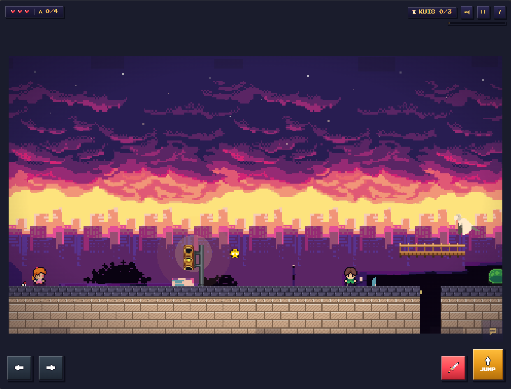
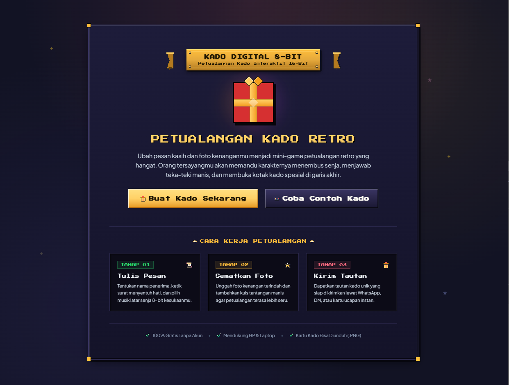
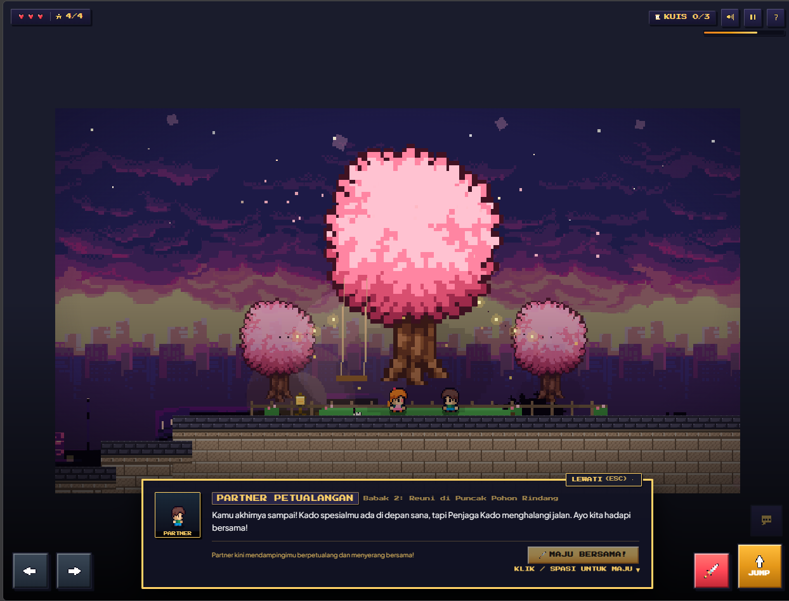
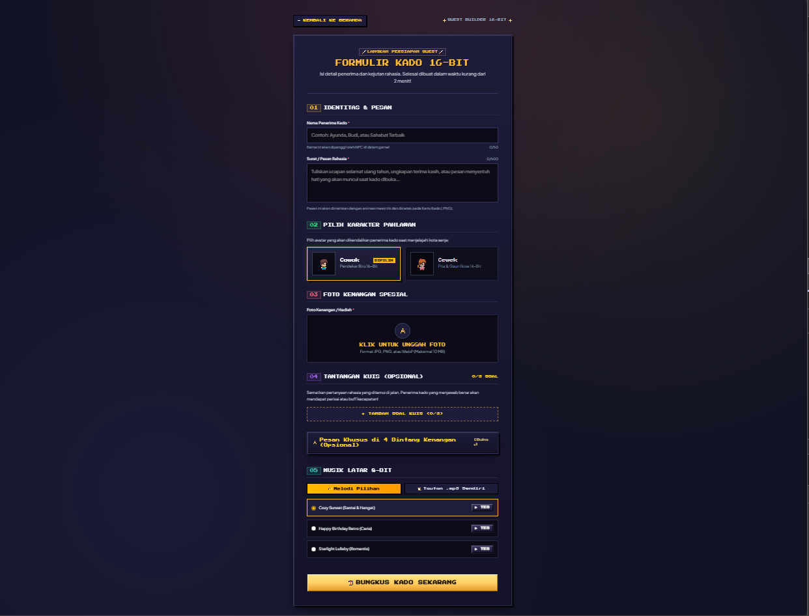
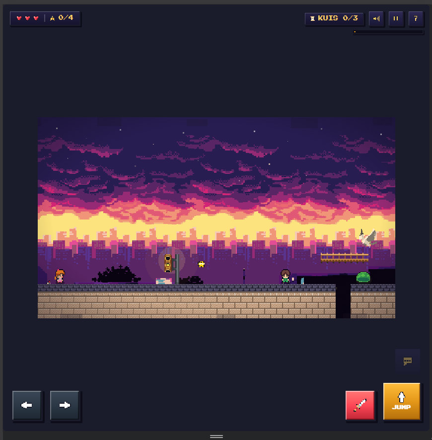

# Digital-8-Bit

> **A Heartwarming 16-Bit HD-2D Retro Action-RPG Interactive Gift Experience**  
> *Ubah ucapan selamat ulang tahun, anniversary, atau ungkapan terima kasih menjadi petualangan game retro 16-bit yang tak terlupakan.*

**Teknologi:** Next.js 16 | React 19 | TypeScript | KAPLAY | Tailwind CSS v4

---

## Hero Showcase



---

## Tentang Digital-8-Bit

**Digital-8-Bit** adalah platform web interaktif yang mentransformasikan kartu ucapan konvensional menjadi petualangan aksi-RPG 16-bit (*Cozy Sunset Fantasy*). 

Penerima kado tidak hanya membaca pesan, melainkan memainkan karakter petualang melintasi atap gedung kota senja, menjawab kuis kenangan pribadi untuk mendapatkan buff tempur, bertemu kembali dengan sang kekasih (*Partner Co-op*) di bawah Pohon Sakura Raksasa, bertarung mengalahkan Naga Penjaga Kado (*Dragon Boss*), mengeksekusi serangan kombo pamungkas *Duo Starlight Slash*, hingga akhirnya membuka kotak kado berisi foto kenangan dan pesan manis yang dapat diunduh sebagai **Kartu Pos Polaroid HD (.PNG)** lengkap dengan stempel prangko petualangan.

Semua dokumen master rancangan sistem, arsitektur teknis, dan filosofi desain game terpusat di:
**[PRD.md](./PRD.md)**

---

## Fitur Unggulan

### 1. 4 Babak Cerita & Prolog Live Cutscene
- **Prolog Sinematik JRPG (`PrologueModal`):** Naskah dialog pembuka bergaya live cutscene yang menceritakan pencurian kado oleh monster bayangan, animasi penutur pixelated, serta panduan kontrol ringkas sebelum gameplay dimulai.
- **Babak 1 (Atap Kota Senja):** Pengenalan mekanik gerak, tebasan pedang, monster slime/bat/skeleton, dan tantangan kuis kenangan.
- **Babak 2 (Puncak Sakura & Reuni Pasangan):** Landmark Pohon Sakura Raksasa, ayunan kayu berdua (*couple swing*), pemulihan nyawa (*Full Heal*), dan bergabungnya Partner sebagai AI Co-op pendamping.
- **Babak 3 (Pertarungan Naga Penjaga Kado):** Penguncian arena segel ungu, pertarungan Dragon Boss berfase Enraged, semburan bola api yang dapat ditebas balik (*deflect*), kibasan ekor, dan eksekusi serangan kombo duo.
- **Babak 4 (Mode Damai Post-Game):** Suasana fajar emas yang damai setelah boss dikalahkan, memungkinkan pemain bersantai berdua di ayunan atau membuka kado kapan saja.

### 2. Arsitektur Hybrid HD-2D (Retina HD UI + 480×270 Virtual Screen)
- **Viewport Game Proporsional:** Resolusi virtual kanvas KAPLAY beresolusi `480×270` piksel dengan kelipatan skala bulat presisi (*pixel-perfect integer scaling*) berasio aspek 16:9 bebas distorsi.
- **Retina HD UI Layer:** 100% teks dialog, title card boss, HUD HP hati, buff chip, combo counter, dan tombol aksi dirender menggunakan lapisan HTML5 + SVG vektor tajam resolusi asli layar perangkat (bebas emoji bawaan OS).

### 3. Langit Dinamis & Atmosfer Taman Sakura
- Transisi gradasi langit berbasis posisi pemain dan status pertarungan (*smooth lerp*): **Senja Jingga Hangat** -> **Malam Berbintang Sakura** -> **Tengah Malam Ungu Naga** -> **Fajar Emas Kemenangan**.
- Efek visual hidup: guguran kelopak sakura acak, 8 kunang-kunang emas di puncak pohon, pendar lampu gantung *fairy lights*, serta efek *hitstop* & *hit-flash* yang memuaskan.

### 4. AI Co-op Partner, Dragon Boss & Duo Starlight Slash
- **AI Partner:** Menemani pemain menapaki kontur atap bertingkat tanpa mengambang, meniru lompatan, dan membantu menyerang monster serta boss secara otomatis setiap 3.0 detik.
- **Dragon Boss (3 Spritesheet Asli):** Menggunakan animasi murni *Idle*, *Breath*, dan *Tail* dari koleksi aset retro Gothicvania tanpa sambungan buatan, dengan hitbox fisik presisi dan indikator HP segmented 9-slice.
- **Finisher Duo Starlight Slash:** Saat HP Boss tersisa 1, boss masuk ke status *Stunned*. Tombol prompt `[F] / TAP SERANGAN DUO!` muncul, memicu animasi *Cut-In Banner* dramatis pemain & partner, tebasan silang emas, dan ledakan konfeti kemenangan.

### 5. Easter Egg Ayunan Berdua & Mode Damai
- Pemain dan Partner dapat duduk berdampingan di ayunan gantung di bawah pohon sakura (`x = 1228`), memicu *soft camera zoom* `1.15x` dan kotak dialog manis JRPG.
- Pemain dapat berdiri kembali kapan saja dengan menekan tombol gerak, lompat, `E`, `Esc`, atau mengetuk layar.

### 6. Personalisasi Lengkap (/create)
- Form pembuatan kado yang ramah pengguna dengan validasi komprehensif.
- Kustomisasi nama penerima, pesan panjang, tautan musik latar, dan pilihan avatar (Laki-laki / Perempuan).
- **Quiz Builder Dinamis:** Hingga 3 soal kuis kenangan dengan 4 pilihan ganda, hadiah buff gameplay (`shield`, `speed`, `power_star`), serta tautan foto petunjuk opsional.
- **Pesan 4 Bintang Kenangan:** Personalisasi kalimat manis yang muncul saat pemain mengumpulkan tiap bintang di perjalanan (maksimal 40 karakter per bintang).

### 7. Engine Audio Chiptune Prosedural (Web Audio API)
- Generator audio 8-bit prosedural zero-file tanpa beban aset eksternal: efek suara tebasan, lompat, damage, checkpoint chime, lonceng angin puncak sakura, hingga jingle kemenangan.
- Dukungan BGM preset berulang (*chiptune loop*) dan URL audio eksternal dengan penanganan aman terhadap kebijakan *browser autoplay restriction*.

### 8. Ekspor Kartu Kado Polaroid (.PNG)
- Hadiah dibuka dengan efek mesin tik dan taburan konfeti.
- Fitur **Simpan Kartu Kado**: Me-render kartu polaroid retro beresolusi tinggi (800×1140 px, anti-aliased font, bevel border) lengkap dengan foto kenangan, ucapan personal, serta **Prangko Foto "MOMEN PETUALANGAN"** yang diambil langsung dari kanvas gameplay saat pertarungan usai.

---

## Galeri Tangkapan Layar

| Beranda Retro Desktop | Prolog Cutscene JRPG |
|:---:|:---:|
| <br>*(Halaman Utama & Preview Kado)* | <br>*(Prolog Sinematik Adegan Klimaks)* |
| **Kustomisasi Kado & Kuis** | **Kontrol Sentuh Mobile (D-Pad)** |
| <br>*(Builder Kuis & Pesan Bintang Kenangan)* | <br>*(Gameplay Responsif di Layar Sentuh Smartphone)* |

---

## Tech Stack & Arsitektur

| Komponen | Teknologi | Keterangan |
| :--- | :--- | :--- |
| **Frontend Framework** | Next.js 16 (App Router) & React 19 | SSR untuk landing & `/create`, Client-Only (`ssr: false`) untuk kanvas game. |
| **Bahasa Pemrograman** | TypeScript 5.0 | Type safety ketat di seluruh entitas game, API payload, dan state manajemen. |
| **Game Engine** | KAPLAY (`v3001.0.19`) | Engine 2D berbasis WebGL, arsitektur ECS terisolasi di dalam `lib/game/`. |
| **Styling & Desain** | Tailwind CSS v4 + Custom Pixel CSS | Resolusi tajam `image-rendering: pixelated`, font `Press Start 2P` & `Plus Jakarta Sans`. |
| **Audio Engine** | Web Audio API + HTML5 Audio | Generator gelombang kotak (*square wave*) prosedural untuk sound effect retro. |
| **Database & API** | Google Apps Script (GAS) + Google Sheets | Penyimpanan kado berbasis spreadsheet serverless tanpa biaya bulanan. |
| **Penyimpanan Gambar** | ImgBB REST API | Kompresi kanvas client-side sebelum upload untuk efisiensi bandwidth. |
| **Pengujian E2E** | Playwright Chromium Engine | Suite QA otomatis untuk pengujian skenario desktop, mobile, console, dan network. |

---

## Menjalankan Proyek Secara Lokal (Quick Start)

### 1. Kloning Repositori
```bash
git clone https://github.com/username/digital-8-bit.git
cd digital-8-bit
```

### 2. Pasang Dependensi
```bash
npm install
```

### 3. Konfigurasi Variabel Lingkungan
Salin file `.env.example` menjadi `.env.local`:
```bash
cp .env.example .env.local
```
Isi variabel berikut sesuai kebutuhan:
```env
# URL Web App Google Apps Script untuk penyimpanan data kado (opsional untuk mode demo)
NEXT_PUBLIC_GAS_URL=https://script.google.com/macros/s/YOUR_GAS_DEPLOYMENT_ID/exec

# ImgBB API Key untuk upload foto kado (opsional, fallback ke direct link jika kosong)
NEXT_PUBLIC_IMGBB_API_KEY=your_imgbb_api_key_here
```

### 4. Jalankan Development Server
```bash
npm run dev
```
Buka [http://localhost:3000](http://localhost:3000) di browser Anda.

### Mode Demo Publik Instan (Tanpa Setup Backend)
Anda dapat langsung mencoba gameplay lengkap dengan 3 tantangan kuis, dialog reuni, dan pertarungan boss naga tanpa perlu menyiapkan Google Apps Script dengan mengunjungi:  
**[http://localhost:3000/play/demo-quiz](http://localhost:3000/play/demo-quiz)**

### 5. Verifikasi Kualitas Kode & Build Produksi
Pastikan seluruh kode bersih dari error tipe data, linting, dan build sebelum deploy:
```bash
npx tsc --noEmit && npm run lint && npx next build --webpack
```

---

## Lisensi & Kredit Aset

- **Kode Sumber:** Dilisensikan di bawah [MIT License](LICENSE).
- **Aset Sprite Retro:** Koleksi sprite platformer retro 16-bit berasal dari lisensi aset publik *Legacy Collection* / *Grotto Escape 2* oleh Ansimuz.
- **Karya & Dedikasi:** Dibuat dengan penuh dedikasi untuk menghadirkan kebahagiaan melalui medium game retro pixel art.
